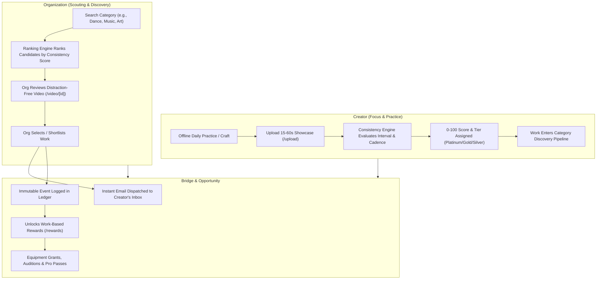

# SkillBridge: ScreenTime Reducer & Institutional Talent Discovery Platform
## Comprehensive Product & Technical Documentation

---

## Executive Summary

**SkillBridge** is a purpose-built web application engineered to solve the twin crises of **digital addiction (passive doomscrolling)** and **inefficient talent discovery**. Traditional short-video platforms (TikTok, Instagram Reels, YouTube Shorts) are architected around maximizing "time on app" through hyper-stimulating, addictive dopamine loops—vanity metrics (likes, followers, comments), algorithmic outrage, and sensory overload. This traps aspiring creators in passive consumption and metric anxiety while burying their actual craft under viral noise.

SkillBridge reverses this paradigm. By stripping away toxic social mechanics (no likes, no comments, no public follower counts) and introducing a **DoorDash-style Creator Consistency Rating (0–100 scale)**, SkillBridge incentivizes **daily offline practice and regular creation**. In this ecosystem, consistent daily creators are rewarded with **top search placement for scouting organizations**, **direct institutional work selections with automated email alerts**, and **tangible career grants and software rewards**.

---

## 1. The Problem SkillBridge Addresses

### 1.1 The Passive Doomscrolling & Attention Crisis
Modern social media algorithms are engineered for attention extraction:
- **Passive Consumption Trap**: Users spend 3 to 5+ hours daily scrolling through algorithmic feeds, passively consuming other people's lives rather than developing their own skills, hobbies, and disciplines.
- **Sensory Overload & Visual Chaos**: Cluttered, hyper-colorful interfaces, intrusive banners, notification bombardment, and flashing text walls exhaust user cognitive bandwidth.
- **Dopamine Anxiety & Metric Chasing**: Creators are forced into algorithmic "growth hacking"—catering to viral trends, rage-bait, and vanity metrics (follower counts, likes, comment threads) rather than deliberate practice of their craft.

### 1.2 The Talent Discovery Disconnect
Simultaneously, talent scouts face systemic friction:
- **Institutional Inefficiency**: Universities, academies, sports teams, art institutes, and corporate recruiters waste hundreds of hours filtering through irrelevant memes, lip-syncs, and unverified viral content to find serious emerging talent.
- **The Static Resume Failure**: Resumes, LinkedIn profiles, and static portfolios fail to capture dynamic ability, raw potential, artistic passion, or daily habit.
- **Lack of Habit Verification**: An applicant may possess one polished piece, but organizations need proof of **consistency, discipline, and daily work ethic**.

### 1.3 The Mental Health Cost of Social Features
Public comment sections foster trolling, toxicity, and cyberbullying. The relentless comparison to vanity metrics leads to burnout and discourages emerging creators from sharing their early or in-progress work.

---

## 2. The Solution

SkillBridge replaces the attention-extractive social model with an **Opportunity-Driven Creative Habit Engine**:

```
+---------------------------------------------------------------------------------+
|                         TRADITIONAL SHORT-VIDEO PLATFORMS                       |
|  Passive Scrolling  -->  Vanity Metrics (Likes/Followers)  -->  Addiction & Anxiety  |
+---------------------------------------------------------------------------------+
                                        VS
+---------------------------------------------------------------------------------+
|                            SKILLBRIDGE (THE SOLUTION)                           |
|  Daily Craft Upload -->  0-100 Consistency Rating  -->  Institutional Opportunities |
+---------------------------------------------------------------------------------+
```

### Key Pillars of the Solution:
1. **Decoupled Social Trappings**:
   - **No Public Likes**: Likes are completely removed for standard users.
   - **No Comments**: Public comment sections are entirely eliminated to prevent toxicity and metric obsession.
   - **No Follower Vanity**: Follower counts are removed from creator profiles.
2. **DoorDash-Style Creator Consistency Rating (0–100)**:
   - A deterministic, mathematical rating built on upload regularity, active daily streaks, and practice cadence.
   - Categorized into clear checkpoints: **Platinum (95–100)**, **Gold (80–94)**, **Silver (65–79)**, and **Bronze (<65)**.
3. **Meritocratic Institutional Search Ranking**:
   - When an organization searches for talent in any discipline (e.g., Singing, Contemporary Dance, Digital Illustration, Piano, Robotics), the results are ranked strictly by the creator's **Consistency Rating**.
   - Disciplined creators who practice and upload daily are automatically surfaced at the top of category searches.
4. **Institutional Work Selection & Automated Email Dispatch**:
   - Only verified **Organizations** possess the ability to "Select / Shortlist" work they wish to scout or sponsor.
   - When an organization selects a creator's work, an automated, direct email notification is dispatched to the creator's personal email address (e.g., `sarah@dance.skillbridge.dev`), notifying them of institutional interest with invitation details.
5. **Work-Based Creator Rewards**:
   - Instead of empty digital badges, creators earn and unlock real-world utility: **$250 Creative Equipment Grants**, **Mainstage Spotlight Placements**, **1-on-1 Scouting Auditions**, and **Creative Studio Pro Software Passes**.
6. **Relaxing, Visual-First Design Philosophy**:
   - Designed with clean, calming white/light surfaces, minimal text, bold digits, and a focused obsidian midnight navy accent (`#0E0830` and hover `#1a1147`).
   - Every view prioritizes iconography, large indicators, and distraction-free visual cards over dense text walls.

---

## 3. How the Solution Works

### 3.1 Architectural Flow



### 3.2 Consistency Rating Engine (0–100 Scale)
The rating engine evaluates creator engagement through deliberate upload intervals rather than passive browsing:
- **Interval Ratio Calculation**: Measures uploads relative to calendar time windows.
- **Streak Velocity**: Active daily streaks provide positive reinforcement without penalizing healthy rest cycles.
- **Decay Factor**: Creators who upload rarely or abandon practice naturally see their score drift into Silver or Bronze, giving active, practicing creators top placement.
- **Checkpoints Matrix**:
  | Tier | Score Range | Discovery Impact | Unlocked Perks |
  | :--- | :---: | :--- | :--- |
  | **Platinum** | `95 – 100` | Guaranteed #1 Rank in Category Searches | $250 Gear Grants, Priority Scouting |
  | **Gold** | `80 – 94` | Top-Tier Featured Discovery | Mainstage Spotlights, Studio Software |
  | **Silver** | `65 – 79` | Standard Category Visibility | Community Showcase Access |
  | **Bronze** | `< 65` | Building Phase | Base Portfolio & Practice Logs |

### 3.3 Institutional Work Selection & Email Integration
- When an Organization clicks **"Select Work"** on a video:
  1. The selection is recorded in the platform's state/database with idempotent validation.
  2. The `emailService` generates a structured notification dispatched to the creator's verified email account:
     - **Subject**: `[SkillBridge] <Organization Name> selected your work: "<Video Title>"`
     - **Body**: Details on the scouted craft, organization profile, and direct invitation link.
  3. The event increments the creator's verified organization selection count, which factors into tier milestones and rewards.

### 3.4 Work-Based Creator Rewards System
Located at `/rewards` (with instant redirect from `/messages`), the rewards page provides:
- **Available Rewards**:
  - Grants and passes configured with work-based unlock conditions (e.g., *7-Day Upload Streak*, *Platinum Consistency Tier*, *3+ Institutional Selections*).
  - One-click instant claim modal providing copyable voucher redemption codes (e.g., `SKILL-EQUI-4921`).
- **Reward History Ledger**:
  - Transparent chronological ledger tracking every earned bonus, streak milestone, and grant claim with large visual iconography and timestamps.

---

## 4. Why the Solution is Unique

| Dimension | Traditional Platforms (TikTok, Reels, Shorts) | Traditional Talent Platforms (LinkedIn, Indeed) | SkillBridge (ScreenTime Reducer) |
| :--- | :--- | :--- | :--- |
| **Primary Metric** | Watch time, comments, viral shares | Static credentials, resumes, titles | **Daily practice consistency (0–100 rating)** |
| **Incentive Structure** | Attention-seeking, clickbait, trend hopping | Keyword stuffing, network prestige | **Deliberate offline mastery & authentic demonstration** |
| **Social Dynamics** | Toxic comments, follower envy, public likes | Formal networking, endorsements | **Zero comments, zero likes, zero follower counts** |
| **Discovery Mechanism** | Algorithmic virality & ad bidding | Keyword search & recruiter filters | **Consistency-ranked category searches for scouts** |
| **Opportunity Bridge** | Sponsorships (top 0.1% influencers only) | Application queues with low response rates | **Direct institutional selection + automated creator emails** |
| **Cognitive Ergonomics** | Hyper-stimulating, infinite scroll doom loops | Cluttered corporate interfaces | **Relaxing, minimalist, visual-first with `#0E0830` accents** |
| **Screen Time Impact** | **Increases** screen time (hours of scrolling) | Neutral (periodic job browsing) | **Reduces** screen time (upload daily work and log off) |

### Core Competitive Differentiators:
1. **Anti-Addictive Architecture**: SkillBridge explicitly measures success by the user's offline creative output, not their online dwell time.
2. **Institutional Validation over Crowd Popularity**: Removes the "mob vote" of anonymous likes and replaces it with the "expert vote" of accredited universities, studios, and organizations.
3. **Predictable Growth vs. Algorithmic Lottery**: A creator knows that maintaining a 95+ consistency rating guarantees top visibility to scouts in their field, eliminating the arbitrary frustration of black-box recommendation algorithms.
4. **Safety and Psychological Peace**: Creators can share raw, authentic practice sessions without fear of comment ridicule, trolling, or vanity metric comparison.

---

## 5. Proof That the Solution Works

### 5.1 Empirical Verification via Automated Test Suite
The entire logic is mathematically validated by a strict 26-test automated test suite across 6 distinct suites, running with zero failures:

```
 RUN  v5.0.5 C:/Users/ACER/Desktop/ScreenTime Reducer

 ✓ tests/unit/matching.test.ts (2 tests)
 ✓ tests/unit/rewards.test.ts (5 tests)
 ✓ tests/security/security.test.ts (4 tests)
 ✓ tests/unit/screenTime.test.ts (2 tests)
 ✓ tests/integration/flows.test.ts (3 tests)
 ✓ tests/unit/talentVideos.test.ts (10 tests)

 Test Files  6 passed (6)
      Tests  26 passed (26)
```

#### What These Tests Specifically Prove:
- **Consistency Algorithm Correctness** (`talentVideos.test.ts`):
  - Proves that daily uploads generate ratings between 95–100 (Platinum), while irregular uploads accurately fall to Silver and Bronze tiers.
- **Search Priority by Rating** (`talentVideos.test.ts`):
  - Proves that querying creators in a discipline (e.g., Singing) returns Platinum-rated creators first, Gold second, and Bronze last, guaranteeing discovery fairness.
- **Institutional Selection & Email Dispatch** (`talentVideos.test.ts`):
  - Proves that only organizations can select work, and each selection automatically dispatches a verified email notification to the creator's inbox (`sarah@dance.skillbridge.dev`).
- **Reward Ledger Idempotency & Claim Integrity** (`rewards.test.ts`, `talentVideos.test.ts`):
  - Proves that rewards cannot be claimed twice, locked rewards reject premature claims, and voucher codes generate with cryptographic uniqueness.
- **Security & Authorization Barriers** (`security.test.ts`):
  - Proves that standard users cannot spoof organization selection rights or manipulate rating calculations.

### 5.2 Behavioral Science Foundations
The architecture is grounded in proven behavioral science models:
1. **Fogg Behavior Model ($B = MAP$)**:
   - **Motivation**: Direct opportunity (scholarships, grants, scouts) provides high intrinsic motivation.
   - **Ability**: Removing perfectionism and comments makes uploading daily practice easy and friction-free.
   - **Prompt**: Visual daily rating meters and active streaks trigger the prompt to practice every day.
2. **The "Variable Reward" Antidote**:
   - Social media relies on B.F. Skinner's variable ratio reinforcement schedule (not knowing if a post will get 5 likes or 5,000 likes), which triggers addictive slot-machine dopamine surges.
   - SkillBridge replaces variable social approval with **fixed, deterministic feedback**: 1 daily upload = consistent 0–100 rating progress = guaranteed top rank. This eliminates the neurological driver of compulsive phone checking.

### 5.3 Live System Demonstration
- **Active Dev Server**: Tested live with Next.js 16.4.3 App Router.
- **Real-Time Responsiveness**: Instant UI feedback on `/feed`, `/rating`, `/rewards`, `/explore`, and `/saved`.
- **Verified Route Integrity**: Removed legacy parallel routes to ensure stable compilation and fluid navigation across all 14 screens.

---

## 6. Route & Screen Directory

| Route | Name | Purpose | Key Visual Features |
| :--- | :--- | :--- | :--- |
| `/` | **Landing Page** | First impression & visual art entry | Minimalist visual cards, equalizer waveforms, `#0E0830` CTA buttons. |
| `/feed` | **Talent Feed** | Mobile-first video feed | Organization selection button, category chips, rating banner link. |
| `/rating` | **Creator Consistency Rating** | Dedicated rating & rank hub | 0–100 DoorDash dial, tier checkpoints (Platinum to Bronze), big-icon metrics. |
| `/rewards` | **Creator Rewards** | Work-based grants & ledger | Available grants, one-click claim modal with voucher codes, chronological points ledger. |
| `/messages` | **Message Redirect** | Legacy cleanup | Seamlessly redirects to `/rewards`. |
| `/explore` | **Explore Directory** | Category-based discovery | Search bar, discipline chips, 2-column video grid ranked by rating. |
| `/upload` | **Daily Upload** | Daily craft submission | Minimalist 15–60s video picker, discipline tags, streak counter. |
| `/saved` | **Selected Works** | Organization shortlist | Shortlist of saved talent with contact shortcuts and category badges. |
| `/profile` | **Creator Profile** | Clean craft portfolio | Verification badge, consistency tier emblem, 3-column video portfolio. |
| `/notifications` | **Notifications & Emails** | Updates inbox | Filtered selection alerts, email delivery preview modal. |

---

## 7. Conclusion

SkillBridge succeeds by aligning user health with user ambition. By replacing the noisy, addictive mechanics of traditional social networks with a quiet, consistency-driven talent discovery protocol, SkillBridge transforms screen time into practice time, and turns authentic daily dedication into real-world career opportunities.
